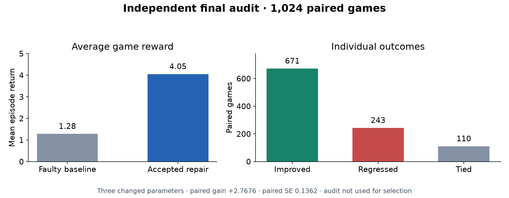
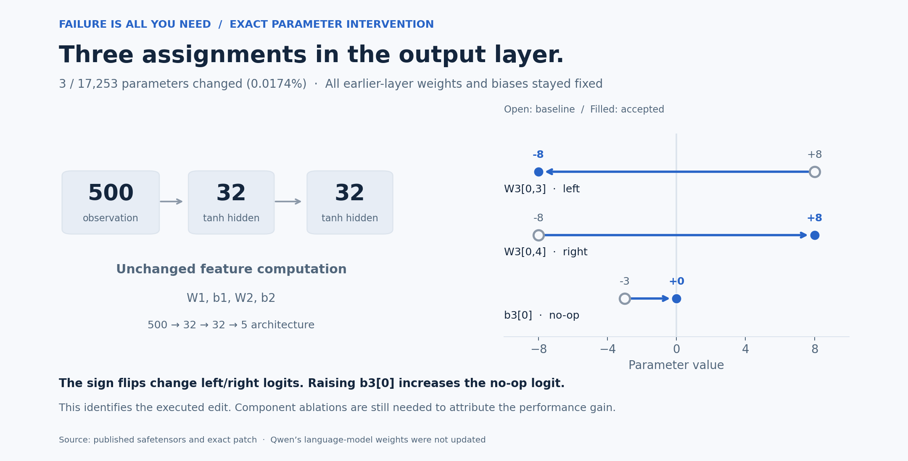
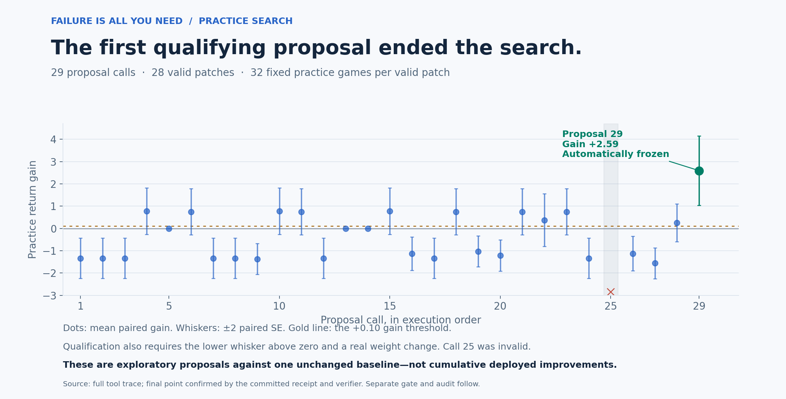
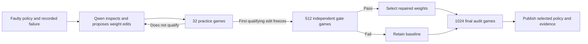
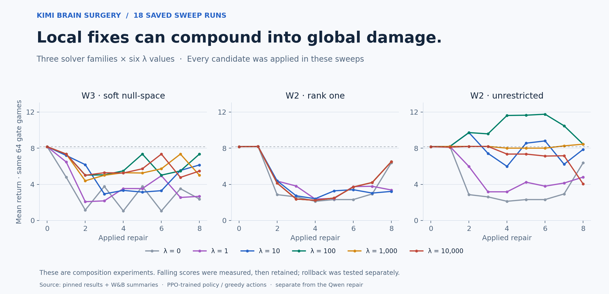
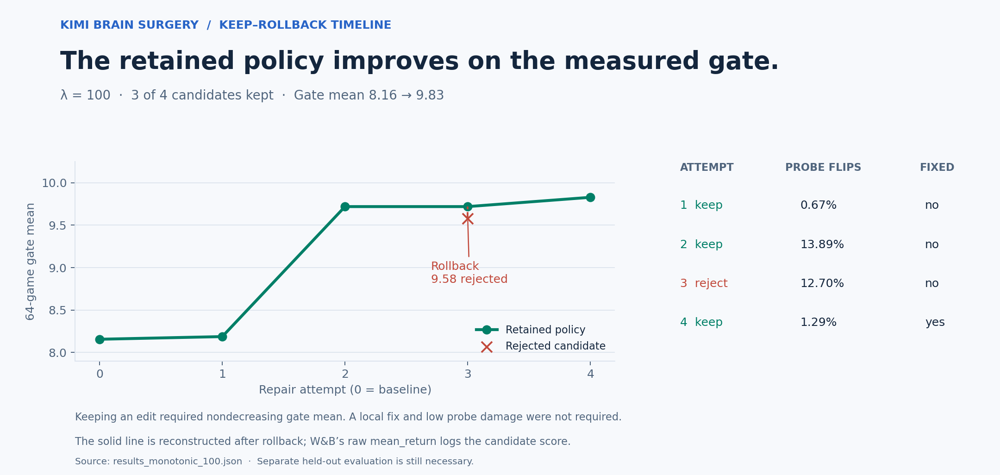
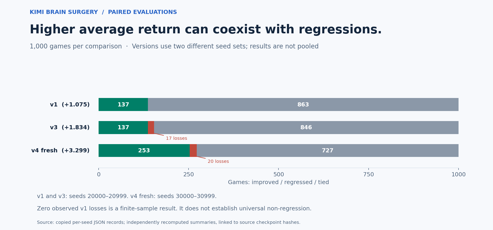

# FailureIsAllYouNeed

**Average-return loop:** [Run 03 release and run 04 protocol](docs/ASTERIX_AVERAGE_RETURN.md). The user has removed per-game preservation vetoes. We now optimize measured average return while retaining individual regressions as learning evidence. Run 03 is released under this revised criterion, with its original failed strict gate disclosed.

**Continuation run 03:** [Learn from the failed audit](docs/ASTERIX_AUDIT_CONTINUATION.md). Starts from run 02’s improved weights, imports all 26 audit-regression cases, retains prior repairs, and reserves a new final audit.

**Regression feedback experiment:** [Learning from rejected Asterix candidates](docs/ASTERIX_REGRESSION_FEEDBACK.md) replays prior regressions, combines their preservation targets with the original corrections, and uses a fresh final audit. Run 02 accepted four updates but failed publication on fresh-audit regressions.

**New cross-game experiment:** [Asterix recursive learning](docs/ASTERIX_RECURSIVE.md) transfers the failure-diagnosis, gradient-training and replay pipeline to an official MinAtar game and a separately released starting policy. The protocol reserves a final audit after selection. [The first trial completed](docs/ASTERIX_RESULTS_2026-11-04.md): 48 candidates, 41 target repairs, zero accepted checkpoints because of regressions.

**From observed failures to tested parameter repairs.**
**Hosted run completed:** [results and live model](docs/HOSTED_RESULTS_2026-11-04.md). AdamW training improved the original PPO policy from 8.8958 to 16.7500 mean return with zero regressions across the 96-start development census. The direct-surgery comparison accepted no edits. **Hosted self-improvement pipeline:** [two-arm design and names](docs/HOSTED_PIPELINE.md). The new pipeline starts both failure-conditioned AdamW training and direct parameter surgery from the exact original PPO checkpoint. HF Jobs executes the experiments, a trajectory dataset preserves evidence, W&B records separate curves, and publication requires audited improvement.


A failure trace gives us a place to look: the observations, decisions, and state
changes that led to an unwanted outcome. Our research question is:

> Given a failed trajectory, what small change to the model's parameters would
> change that outcome while preserving performance elsewhere?

We work backward from behavior, propose an explicit weight edit, replay and
evaluate it, and keep it only if it passes a predefined acceptance check.
The long-term aim is a repeatable **observe → diagnose → edit → verify** loop.

This repository publishes our first completed **tool-assisted, verifier-accepted
Breakout repair**. It establishes improved average performance after a sparse
LLM-proposed edit. Preventing the particular diagnostic failure remains an open
objective: that miss was **not** prevented in this run.

[Live repaired policy](https://huggingface.co/spaces/HarleyCooper/weight-space-breakout-qualified-repair-demo-01)
· [Published weights](https://huggingface.co/HarleyCooper/weight-space-breakout-qualified-repair-01/tree/44bef3f4fe96d48b9d67f308d7734f4693846b91)
· [Completed HF Job](https://huggingface.co/jobs/HarleyCooper/6aea9774c78863f9c6322027)
· [W&B run](https://wandb.ai/christian-cooper-us/weight-space-breakout/runs/7a31ec5872dd3f77)

**Parallel methods companion:** [Kimi's parameter-repair mathematics](docs/KIMI_METHODS.md)
· [Full LaTeX source](docs/kimi-parameter-repair.tex)
· [Typeset PDF](docs/kimi-parameter-repair.pdf)
· [W&B connection and evidence](docs/WANDB.md)

## Evaluation mode matters

The accepted improvement below is for **sampled actions**. A posthoc greedy check
on the same 1,024 audit seeds scored **10.2471 → 1.5674** (local NumPy 2.4.1,
float32). The patch is therefore not an across-mode improvement. The recorded
diagnostic miss remains unprevented. See [the reconciliation](docs/CROSS_REPO_RECONCILIATION.md).

Latest: [batch solver findings](docs/BATCH_REPAIR_FINDINGS.md) · [end-of-day status](docs/STATUS_2026-11-03.md) ·
[paired evaluation dataset](https://huggingface.co/datasets/HarleyCooper/failure-is-all-you-need-evaluations).

## The result

A Qwen editor inspected and proposed changes to a deliberately damaged,
handwritten game policy. The policy has **17,253 parameters** in a
`500 → 32 → 32 → 5` tanh network. Qwen's own weights were unchanged.

| Measurement | Games | Baseline mean return | Repaired mean return | Paired gain | Paired SE |
| --- | ---: | ---: | ---: | ---: | ---: |
| Practice qualification, used during search | 32 | 1.8750 | 4.4688 | +2.5938 | 0.7788 |
| Independent acceptance gate | 512 | 1.2305 | 3.7813 | **+2.5508** | 0.1954 |
| Independent final audit | 1,024 | 1.2803 | 4.0479 | **+2.7676** | 0.1362 |



The final audit contained **671 improvements, 243 regressions, and 110 ties**.
Acceptance concerned average return. It did not guarantee improvement on each
seed, and neither policy cleared the board in these 1,024 audit games.

The accepted patch changed **3 parameters (about 0.0174%)**:

| Parameter | Before | After |
| --- | ---: | ---: |
| `W3[0,3]` | +8 | −8 |
| `W3[0,4]` | −8 | +8 |
| `b3[0]` | −3 | 0 |

The first two changes reverse the sign of the hidden feature's contribution to
the left/right action logits. The bias change increases the no-op logit relative
to its previous value. These are direct consequences of the network equations;
the separate causal contribution of each change to the return gain has not been
established by an ablation study.



The editor used **33 model turns**: four inspection calls and 29 proposal calls.
Twenty-eight proposals were valid; one was rejected for an overlong diagnosis.
The first proposal that met the practice rule ended editing automatically.
Its independent gate passed, and the accepted weights were published. The live
Space reproduced the verifier's saved episode exactly. Two additional fresh
inference checks scored 7 and 9; those examples are deployment checks, not another
performance estimate.



The proposal chart shows mean paired practice gain with ±2 paired standard
errors. These are exploratory proposals against the same baseline, not
successive deployed improvements. Call 25 was invalid and has no score.
The final point comes from the committed submission receipt and verifier;
all other scored points come from tool feedback in the full trace.

## How the experiment worked



- Every proposal began from the same faulty baseline and contained at most 64
  scalar assignments. Edits did not accumulate during search.
- Qualification and acceptance each required an actual weight change, mean gain
  greater than 0.10, and gain greater than twice the paired standard error.
- Practice seeds were `4040000–4040031`; gate seeds were `4060000–4060511`;
  final audit seeds were `4090000–4091023`. Gate and audit results were not
  available through the editor's tools.
- The diagnostic replay used seed `314159`. Rescuing it was **not an acceptance
  requirement** in this frozen protocol. Both the controlled replay and the full
  deployed episode still ended in a miss.
- Prime Inference supplied `qwen/qwen3.6-35b-a3b`. HF Jobs CPU ran the existing
  environment, tools, verifier, and final audit. There was no editor-turn cap;
  the rollout had a 60-minute operational timeout.

The prior Prime-hosted launch failed before supplying a trace. That service
failure is preserved in the evidence, with no invented performance score.

## What “working backward” means

The target is an **inverse problem**: find a parameter change consistent with a
desired behavioral correction and preservation constraints. Usually many edits
could change a decision, so a failure does not identify a unique correct patch.

Gradient descent already uses errors to compute parameter updates through
backpropagation. Our distinction is the proposal mechanism: an LLM reads weights
and failure evidence, writes a bounded patch, and receives practice feedback.
This run used no gradient computation or training loop. We are not reconstructing
or reversing the model's training trajectory. This particular starting policy
was handwritten and has no gradient-descent history to reverse.

Tensor shapes describe the architecture; weight values, activations, and
trajectories provide evidence about behavior. A sparse successful intervention
does not by itself prove that a behavior is uniquely located in those parameters.

See [the research idea](docs/IDEA.md) and [the exact protocol](docs/PROTOCOL.md).

## Kimi's analytic repair work

The parallel [KimiBrainSurgery project](https://github.com/HarleyCoops/KimiBrainSurgery)
uses constrained numerical solvers to edit a PPO-trained game policy.
We have added a [full mathematical companion](docs/KIMI_METHODS.md), with
[LaTeX source](docs/kimi-parameter-repair.tex) and a
[compiled PDF](docs/kimi-parameter-repair.pdf), grounded in its pinned code
and [20 W&B runs](https://forge.coreweave.com/wandb/christian-cooper-us/kimi-brain-surgery).

It derives the exact W3 readout edit, its soft null-space penalty, the rank-one
and unrestricted W2 updates, the λ sweeps, and the keep/rollback rule.
W2 uses analytic tanh derivatives and local corrections. These methods solve
for a desired behavioral change under preservation constraints; they do not
reverse the original training trajectory.



The sweeps applied every candidate, including damaging edits. The separate
monotonic run retained only candidates whose mean on the reused gate did not
decrease. Its actual retained-policy curve is shown below; rejected candidate
scores remain visible.



| Kimi checkpoint | Evaluation seeds | Baseline mean | Repaired mean | Paired gain | Wins / losses / ties |
| --- | --- | ---: | ---: | ---: | --- |
| v1 | 20000–20999 | 8.694 | 9.769 | +1.075 | 137 / 0 / 863 |
| v3 | 20000–20999, reused | 8.694 | 10.528 | +1.834 | 137 / 17 / 846 |
| v4 | 30000–30999, fresh | 8.886 | 12.185 | +3.299 | 253 / 20 / 727 |



These are saved Kimi results, recomputed from per-seed files; this documentation
update did not rerun those repairs. v1's zero observed losses does not establish
universal non-regression. Once earlier evaluation failures informed later
repairs, that old set became development data. v4's fresh set still shows
regressions alongside a higher mean.

The [methods document](docs/KIMI_METHODS.md) keeps source hashes, original
checkpoint hashes, and W&B run IDs together. It also describes a future
interface for combining the projects: editor-selected targets, solver-produced
edits, and independent counterfactual and preservation checks. That combined
loop has not yet been demonstrated. Kimi's greedy PPO policy and our sampled,
handwritten policy are different experiments; their absolute scores are not
a common leaderboard.

## Reproduce the published result

Python 3.11+ and a small CPU are sufficient. No API key, GPU, hosted job, or new
editor call is needed to verify the saved result.

```bash
git clone https://github.com/HarleyCoops/FailureIsAllYouNeed.git
cd FailureIsAllYouNeed
python -m pip install -r requirements.txt
python scripts/reproduce.py
```

The default command checks file hashes, both policy fingerprints, the exact
three-parameter patch, per-seed scores, reported statistics, and the acceptance
decision. To replay all 32 practice, 512 gate, and 1,024 audit games for both
policies with the pinned simulator:

```bash
python scripts/reproduce.py --replay
```

Replaying frozen weights is deterministic in the pinned environment. Generating a
new Qwen conversation is stochastic and is a new experiment, not a guarantee of
the same patch. The original hosted job script and full conversation are included
as provenance; the original launch script uses account-specific paths and is not
a portable one-click launcher.

To regenerate the six data figures and check the documented solver algebra:

```bash
python -m pip install -r requirements-figures.txt
python scripts/render_figures.py
python scripts/render_kimi_figures.py
python scripts/check_kimi_math.py
```

The figures use saved numerical records and checkpoint values. No new model
calls or rollouts are made. The [methods page](docs/KIMI_METHODS.md) includes
LaTeX build instructions. `CHECKSUMS.json` covers the published snapshot;
regenerating a plot or PDF may change its file bytes.

## Evidence map

| Artifact | What it records |
| --- | --- |
| [Summary](results/qualified-repair-01/summary.json) | Metrics, hashes, seeds, execution identity, and scope |
| [Paired scores](results/qualified-repair-01/paired_scores.csv) | Every baseline/repaired score for all three splits |
| [Exact patch](results/qualified-repair-01/patch.json) | Accepted scalar assignments |
| [Full trace](results/qualified-repair-01/trace-raw.json) | Qwen messages, tool calls, and scoring record |
| [Verifier report](results/qualified-repair-01/verifier-report.json) | Practice qualification, gate, audit, and failure replay |
| [Frozen plan](results/qualified-repair-01/plan.frozen.json) | Rules recorded before the HF execution |
| [Checkpoints](checkpoints/) | Original and accepted NumPy-compatible safetensors |
| [Deployment proof](results/qualified-repair-01/latest-deployment-check.json) | Pinned live checkpoint and exact replay match |
| [Source provenance](vendor/SOURCE.json) | Original environment commit and file hashes |
| [Proposal history](results/qualified-repair-01/proposal_history.csv) | Every proposal call and its practice result, with source labels |
| [W&B verification](results/qualified-repair-01/wandb-verification.json) | Live MCP query matched the accepted Qwen run |
| [Kimi provenance](results/kimi/provenance.json) | Separate source commit, 23 copied result files, checkpoint hashes, and 20 W&B run IDs |
| [Kimi mathematics](docs/kimi-parameter-repair.tex) | Code-grounded derivations, assumptions, and proposed combination interface |

## What remains to demonstrate

This is one completed repair of a planted fault. It does not establish sustained
recursive improvement, generalization to new game rules, or successful repair of
Cree or Dakota language models. The held-out games test fresh seeds in the same
simulator and distribution. Repeatedly using those seeds for future selection
would make them development data; future trials need new reserved evaluations.

The next scientific target is specific: **prevent a recorded failure under a
controlled replay, then pass a separate preservation test**. Any claim that an
edit isolated a causal mechanism also needs comparisons such as component
ablations and control edits. More checkpoints alone would not establish that.

## Credit and provenance

This is an independent conceptual replication attempt inspired by
[Sparks of Weight-Space Programming](https://rikiyat.github.io/blog/weight-space-programming/)
by **Rikiya Takehi, Jayden Teoh, Alex Zhang, and Omar Khattab**.
[Original experiment logs](https://github.com/RikiyaT/lm_understand-logs/tree/main/exp1_which_game)
· [Original announcement](https://x.com/rikiyatakehi/status/2117313742891327994).

Our simulator, handwritten policy, planted fault, editor, and tool-assisted
evaluation differ from their experiment. These are our own results, not a rerun
of their original PPO checkpoint or a reproduction of their reported scores.
The name of this repository expresses a research direction; a failure still
needs context, an objective, and independent verification to become a useful
repair signal.

Environment source is preserved from
[`weight-space-breakout-pipeline@0f4697c`](https://github.com/HarleyCoops/weight-space-breakout-pipeline/tree/0f4697c6c8cbfa48e96220c4e59881f5edfbd0b5).
Published November 3, 2026 (America/Winnipeg); raw execution records retain UTC.
Code and project artifacts are provided under the [MIT license](LICENSE), with
the upstream attribution retained. Original third-party reference weights are
not bundled.
