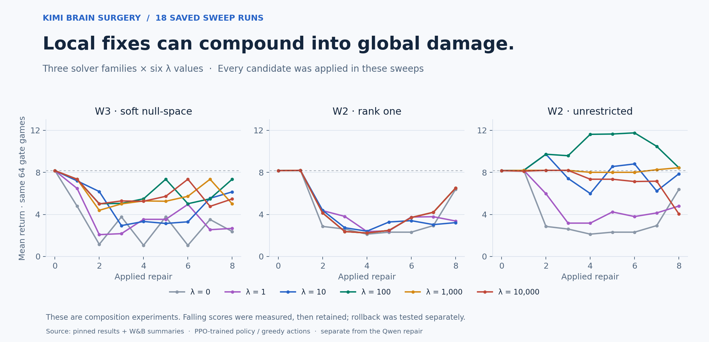
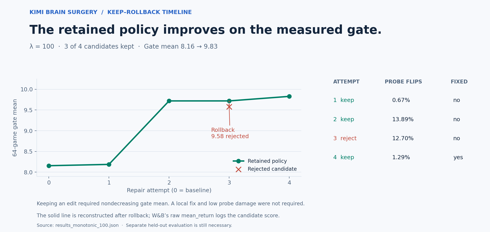
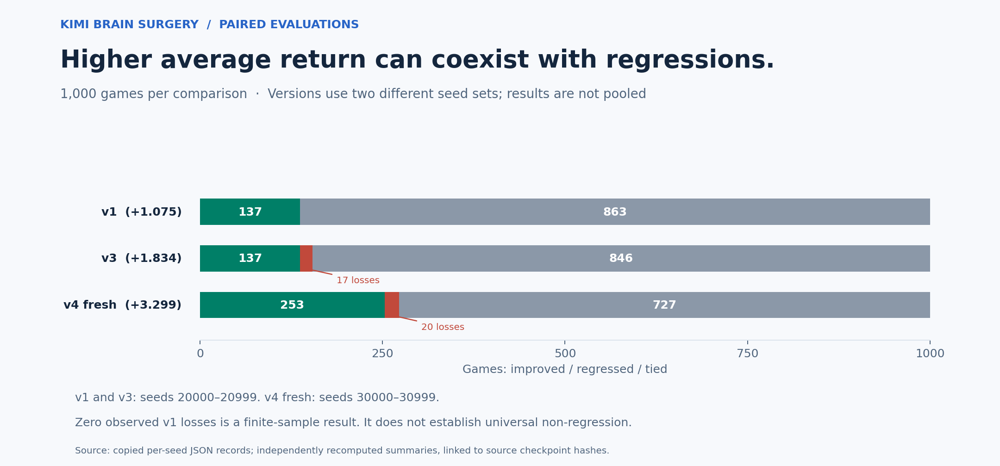

# Kimi's parameter-repair method

[Full mathematical derivation (PDF)](kimi-parameter-repair.pdf)
· [Editable LaTeX source](kimi-parameter-repair.tex)
· [W&B project](https://forge.coreweave.com/wandb/christian-cooper-us/kimi-brain-surgery)
· [Pinned implementation](https://github.com/HarleyCoops/KimiBrainSurgery/tree/13cfaec9f484a1a8864349a814bfd62905022a05)

This is a mathematical companion to HarleyCoops' parallel work built with
Kimi. It documents the implemented solver and saved results at the linked
commit. We have not rerun those repairs or combined their scores with our
separate Qwen experiment.

The document covers the policy equations, failure mining, per-unit logit
diagnosis, the naive and protected W3 edits, rank-one and unrestricted W2
updates, nonlinear correction steps, λ sweeps, keep/rollback, paired
evaluation, and a proposed interface for combining the projects.

## The common constrained update

Given a target behavioral correction, solve for an edit whose cost balances
parameter movement and disturbance to protected observations:

$$
\min_{\delta}\frac{1}{2}\delta^T M\delta
\quad\text{subject to}\quad a^T\delta=t,
\qquad
\delta^*=\frac{tM^{-1}a}{a^TM^{-1}a}.
$$

Here `a` is the target decision's sensitivity, `t` is the required logit-gap
change, and `M` defines the preservation cost. The formula assumes a positive
definite metric and a nonzero sensitivity. Implementations use linear solves.

| Solver | Parameter edit | What is exact? | What is protected? |
| --- | --- | --- | --- |
| W3 naive | Opposite updates to wrong/saving output columns | The selected pair's logit-gap change | Minimum edit size |
| W3 soft null-space | Same two-column update, with `M = I + λHᵀH/N` | The selected pair's gap and probe-logit movement | Squared movement of sampled probe logits |
| W2 rank one | `ΔW2 = u_f vᵀ` | Preactivation change; tanh response is locally approximated | First-order hidden-activation movement |
| W2 unrestricted | All 32 × 32 entries available; 32 small block solves | Same local approximation | First-order hidden-activation movement plus Frobenius edit size |

“Null-space” is a soft penalty in this implementation, not guaranteed zero
interference. “Full-rank” means the update is unrestricted; it need not have
rank 32. The W2 methods use analytic tanh derivatives. They avoid a
gradient-descent training loop, but they are not derivative-free.

The full LaTeX document derives each objective and normalization, including
the symmetric half-updates in W3, the diagonal rank-one metric, the block Gram
matrices for W2, and the norm cap and eight-step local correction loop.

## What the experiment curves mean



All 18 sweep runs **apply each candidate regardless of whether return falls**.
They measure composition and interference. Their scoring function is named
`gate` in the source, but these loops do not use it as a promotion filter.



The separate monotonic run keeps an edit if its mean on the 64 reused gate
games does not decrease. In the saved run, three of four candidates were kept;
two kept edits did not fix the particular stored failure observation.
The criterion does not additionally require a local fix, low probe damage,
or no regressions on previously repaired observations.

W&B's `mean_return` records candidate scores, including rejected candidates.
The figure reconstructs the retained policy after rollback from the saved
`kept` flags. The complete source history supplies the curve; returned MCP
history points were also checked individually against it. The MCP response
marks its retrieval as sampled, and that metadata is preserved.

## Paired evaluation results

| Policy | Seeds | Baseline | Repaired | Paired gain | Wins / losses / ties |
| --- | --- | ---: | ---: | ---: | --- |
| v1 | 20000–20999 | 8.694 | 9.769 | +1.075 | 137 / 0 / 863 |
| v3 | 20000–20999, reused set | 8.694 | 10.528 | +1.834 | 137 / 17 / 846 |
| v4 | 30000–30999, fresh set | 8.886 | 12.185 | +3.299 | 253 / 20 / 727 |



These values are recomputed from all saved per-seed scores. v1's saved
bootstrap 95% interval for the mean paired gain is **[0.851, 1.313]**.
The 1,000-game v1 set includes its earlier 64-game pilot. Zero observed
losses is a finite-sample result, not proof of universal non-regression.

The source analysis identifies an ascent/pre-positioning blind spot in the
old descending-ball miner. The later flight miner makes that class visible;
v4 still has losses on fresh seeds. Once failures from the old evaluation
set informed later repairs, that set became development data. Its full
1,000-seed reevaluation is preserved under the original `contaminated17`
filename: 17 failures informed development, but the file contains all 1,000
paired scores. It is not presented as fresh evidence.

## Traceability and regeneration

- [Copied source result records](../results/kimi/) include all 18 sweeps,
  the monotonic history, and per-seed evaluations.
- [Provenance manifest](../results/kimi/provenance.json) pins the source
  commit, file hashes, original checkpoint hashes, and all 20 W&B run IDs.
  Checkpoints remain in the original project.
- [Recomputed paired summaries](../results/kimi/paired-summary.json) keep
  the different seed sets and evaluation roles explicit.
- [MCP history receipt](../results/kimi/wandb-monotonic-history.json)
  preserves the server's sampling and coverage metadata.

From the repository root:

```bash
python -m pip install -r requirements-figures.txt
python scripts/render_kimi_figures.py
python scripts/check_kimi_math.py
cd docs
pdflatex -interaction=nonstopmode -halt-on-error kimi-parameter-repair.tex
pdflatex -interaction=nonstopmode -halt-on-error kimi-parameter-repair.tex
```

The algebra checks validate the documented constraints and first-order
derivative identities. They do not replay Kimi's experiments. Regenerating
figures or a PDF can change artifact bytes; `CHECKSUMS.json` describes the
published snapshot before regeneration.

## Combining the projects later

The natural interface is: an editor proposes a behavioral target and protected
observations; a numerical solver computes a candidate edit; an independent
verifier checks both the target failure and broader preservation; accepted
weights become the next incumbent. The PDF derives a possible multi-state
constraint extension and explicitly labels it as future work.

The current projects use different baselines and action selection: Kimi's
PPO-trained policy is evaluated greedily, while our Qwen trial repairs a
handwritten, deliberately damaged policy with sampled actions. Their absolute
scores are not a common leaderboard. Neither experiment has demonstrated
repair of a Cree or Dakota language model.
